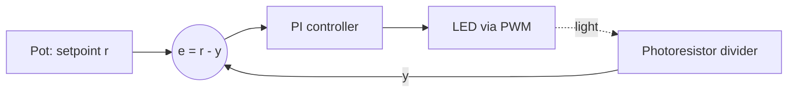

# Closed-Loop Light Controller (Arduino UNO)

A small feedback-control project built using an Elegoo Uno R3. A potentiometer sets a target light level, an LED shines on a photoresistor, and a PI controller adjusts the LED so the measured light matches the target. A 16x2 LCD shows the pot input or the measured sensor voltage, and a button switches between closed-loop (PI) and open-loop control so the two can be compared directly.

## How it works

- **Setpoint (r):** The pot voltage on A0, 0 to 5 V.
- **Measurement (y):** The photoresistor voltage divider on A1. More light means a lower photoresistor resistance, so the voltage rises.
- **Actuator (u):** The LED on D9, driven with PWM (`analogWrite`).
- **Controller:** A PI loop running every 5 ms (200 Hz). The integrator is clamped for anti-windup, and switching from open loop to PI is bumpless (the integrator is preloaded with the current output).
- **Disturbance:** Room light. Shining a flashlight on the sensor or covering it shows the loop compensating.

### Modes

| Control | Function |
|---|---|
| Button on D7 | Switches the display between the pot input and the measured sensor voltage |
| Button on D8 | Switches between PI (closed loop) and OPEN (pot drives LED brightness directly) |

In PI mode the pot is a target for the sensor voltage. In OPEN mode the pot sets LED brightness with no feedback. The display shows `PI` or `OPEN` in the bottom-right corner.

## Hardware

- Elegoo UNO R3 and breadboard
- 1x 10k potentiometer
- 1x LED and a 220 ohm resistor
- 1x photoresistor and a 10k resistor
- 2x push buttons
- Male-to-male jumper wires

## Wiring

### Controller I/O

| Arduino pin | Connection |
|---|---|
| A0 | Setpoint pot wiper (outer pins to 5V and GND) |
| A1 | Divider node: 5V - photoresistor - **A1** - 10k - GND |
| D9 | 220 ohm resistor, then LED anode (cathode to GND) |
| D7 | Button to GND (internal pull-up) |
| D8 | Button to GND (internal pull-up) |

### LCD1602

Matches `LiquidCrystal lcd(12, 11, 5, 4, 3, 2)`.

| LCD pin | Name | Connection |
|---|---|---|
| 1 | VSS | GND |
| 2 | VDD | 5V |
| 3 | VO | GND |
| 4 | RS | D12 |
| 5 | RW | GND |
| 6 | E | D11 |
| 11 | D4 | D5 |
| 12 | D5 | D4 |
| 13 | D6 | D3 |
| 14 | D7 | D2 |
| 15 | A | 5V through 220 ohm |
| 16 | K | GND |

Pins 7 to 10 are unused (4-bit mode).

## Limitations

- **Nonlinear sensor:** A photoresistor's response is roughly a power law, so the loop gain is higher at low light levels than at high ones. Gains tuned for bright targets can oscillate at dim ones.
- **Reachable range only:** The sensor voltage can only span from the ambient-light reading (LED off) to the reading at full LED brightness. Targets outside that range saturate the LED, and the loop cannot reach them.
- **Slow, asymmetric response:** The photoresistor takes tens of milliseconds to respond and falls more slowly than it rises, which limits how high the integral gain can go.
- **Noise:** The photoresistor reading is sensitive to ambient flicker and loose breadboard contacts. A few sample averaging is done in software; further smoothing may help.
- **Not a calibrated light meter:** Readings are voltages, not lux, and drift with temperature.

## Possible improvements

- A feedforward term based on a measured LED-to-sensor calibration curve
- Gain scheduling by target level to handle the sensor nonlinearity
- A low-pass filter on the sensor reading to reject spikes
- Serial commands to set the target for repeatable step-response tests
- Logging step responses and comparing PI with open-loop disturbance rejection

## Results

### Open-Loop vs. Closed-Loop Response
The system was evaluated under open-loop control (direct potentiometer drive) versus closed-loop PI control Kp = 1.0, Ki = 5.0. These graphs from the Arduino IDE Serial Plotter display two lines, the blue line tracks the voltage at the potentiometer and the orange tracks the photoresistor voltage. For both there is a 1V gap when the poteniometer value is at 0, this is due to ambient light from the room, this could be solved by covering the LED and photoresistor, but the controller still tracks well in ambient light.

| Open-Loop Behavior | Closed-Loop PI Tracking |
| :---: | :---: |
|  |  |

- **Open-Loop:** Exhibits lack of real-time error correction and higher susceptibility to external disturbances. Does not follow the poteniometer values closely, increasing much faster.
- **Closed-Loop PI:** Actively minimizes steady-state error, smoothly tracking step inputs and maintaining robust setpoint regulation. With the current Kp and Ki there is still some inaccuracy but displays a much closer tracking.

